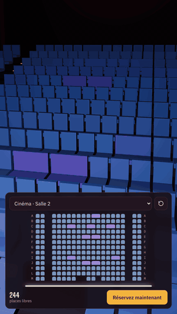

# Seat View

Pick a seat and see the show from it before you book: cinema halls generated from booking seat maps, and the Roman theatre of Carthage for the Festival International de Carthage. Runs in any browser.



*Recorded from the live page: tap a seat on the plan, the camera moves to that seat at seated eye height.*

**Live demo:** https://alaabelghith.github.io/lab/seat-view/ (works on phones; no app, no plugin) · Carthage: https://alaabelghith.github.io/lab/seat-view/carthage.html

## How it works

- **Seat map in, hall out.** A booking seat map lists every seat with its row, number, type (standard, duo, wheelchair) and grid column. `src/adapter.js` turns it into one compact string per row, back row first: `A:ss.ssssssssddsssss.ss` (`s` seat, `d` duo half, `w` wheelchair place, `.` empty cell).
- **Aisles from the grid.** A column that is empty in at least 75 % of the full-width rows is treated as an aisle and drawn wider. Other gaps stay as gaps, and seat numbers skip them the way booking systems do.
- **Procedural room.** Stadium rake (0.30–0.34 m per row), 1.05 m row pitch, side walls with acoustic slats, step lights on every aisle, curtains, and a 2.39:1 screen sized from the seating width.
- **Fast.** All seats of a hall are two `InstancedMesh` objects (cushions and backs), so a 400-seat hall is two draw calls.
- **Sit anywhere.** A click on the 3D seats (raycast) or on the 2D plan flies the camera to seated eye height (1.15 m) facing the screen. Drag to look around. The page also computes the distance to the screen, how much of the view the screen fills (THX recommends about 36°) and the head tilt.

## Théâtre romain de Carthage (`carthage.html`)

The festival sells two unnumbered categories, **Chaises** (chairs on the orchestra) and **Gradins** (stone tiers), so this view has no seat numbers: click anywhere on the plan or on the tiers and chairs in 3D, and the camera sits there. The bowl is built from measurements taken on satellite imagery (≈ 42 m outer radius, ≈ 14 m orchestra, ≈ 33 tiers, ≈ 29 × 14 m festival stage) as one stepped lathe; stairs, walkway, chairs, stage, LED screens and light beams are procedural. The venue picker links both pages.

## The demo data

20 real halls (16 distinct layouts) from three multiplexes, shown as *Cinéma A / B / C*. Rows, seat numbers, duo seats and wheelchair places come from the halls' public seat maps. Room depth, row rise and screen size are estimates until a venue shares its plans.

`data/halls.json` holds every hall; `index.html` carries the same data inline so the page is a single file.

## Plugging into a booking flow

The viewer is meant to sit next to an existing booking, not replace it:

1. **Link-out:** a "see the hall in 3D" link per showtime, and the book button deep-links back to the booking page.
2. **Embedded:** a 3D toggle beside the 2D seat table, fed with the seat map the booking page already loaded. The seat id is `row + number` (e.g. `F11`), the same id the 2D table uses.
3. **Live availability:** greying out taken seats from the per-session seat status (needs the venue's API access).

## Run it locally

```
python -m http.server 8080
```

then open http://localhost:8080 (on Windows, `serve.bat` does both). The first load needs internet: Three.js and the fonts come from a CDN.

Test the adapter (Node 18+):

```
node test/adapter.test.mjs
```

## Files

| Path | Contents |
|---|---|
| `index.html` | Cinema viewer: scene, plan, hall picker (single file) |
| `carthage.html` | Théâtre romain de Carthage viewer (single file) |
| `data/halls.json` | The 16 hall layouts |
| `src/adapter.js` | Seat-map JSON ↔ hall format |
| `test/adapter.test.mjs` | Round-trip test on all 16 layouts |

## Status

Working: every hall, seat picking in 3D and 2D, phone and desktop layouts.

Not finished: real room measurements per hall, live seat availability, a packaged web component for embedding.

---
Built with AI coding assistance; concept and direction by Alaa Belghith, working as Anything Visual: [portfolio](https://alaabelghith.github.io).
Three.js is MIT licensed.

Licence: MIT, see [LICENSE](LICENSE). Reuse it, credit Alaa Belghith.
